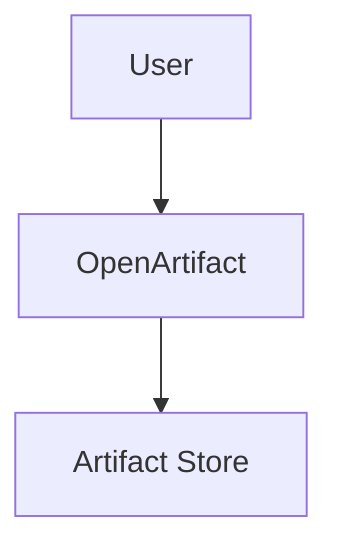

# Architecture Diagrams

This directory contains architecture diagrams for OpenArtifact.

## Diagram Types

| Type | Location | Format |
|------|----------|--------|
| System Context | `context/` | Mermaid / SVG |
| Building Block | `building-block/` | Mermaid / PlantUML |
| Runtime | `runtime/` | Mermaid / PlantUML |
| Deployment | `deployment/` | Mermaid / SVG |

## Preferred Format

**Mermaid** is preferred for text-based diagrams that can be rendered directly in Markdown.

Example:

## Conventions

- Use clear, descriptive filenames
- Include a brief caption in the filename or a companion README
- Keep diagrams at an appropriate level of detail for their purpose
- Prefer SVG for final published diagrams
- Use source files (Mermaid, PlantUML) for maintainable editing
